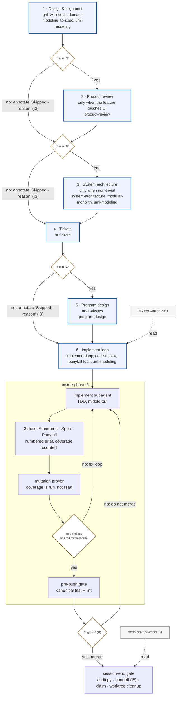
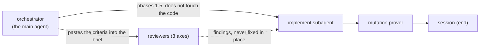
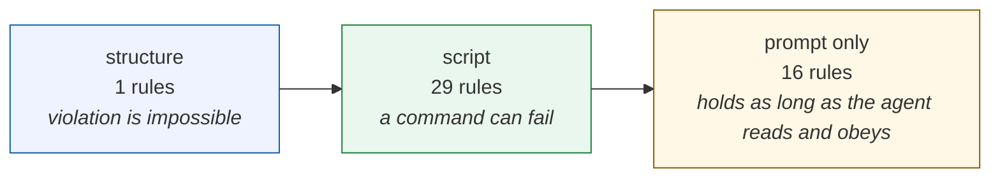

# Workflow map — generated

> **Generated by `gen-flow.py`** from `WORKFLOW.md`, `phases/*.md`,
> `INVARIANTS.md`, `REVIEW-CRITERIA.md`, `audit.py`. Do not edit by hand: the
> map is a view of the sources, and every node comes from them.
> Regenerate: `python3 gen-flow.py`. Verify: `python3 gen-flow.py --check`.
> To look at it: `python3 -m http.server` and open `render-flow.html` (needs the
> network: mermaid comes from a CDN).

**Today's numbers** — phases: 6 · transversal files: 2 ·
load-bearing rules: 46 (structure 1,
**script 29**, **prompt only 16**) ·
invariants: 9 · checks in `audit.py`: 19 ·
general rules: 8 · review axes: 3

## 1. Pipeline

## 2. Who does what

## 3. Where each check is enforced

The complete inventory, rule by rule, is the table below: **no rule is
omitted**.

| rule | where | enforced by | level |
|---|---|---|---|
| A rule change carries a RATIONALE.md entry in the same PR (B-025/14) | General rules | **structure** (pre-commit hook `guards/hooks/pre-commit-rationale` rejects a commit that touches `phases/*.md` or `WORKFLOW.md` without staging `RATIONALE.md`; `--no-verify` is the documented escape hatch) + script (`audit.py check_rationale_entry_in_pr` catches what slipped past, e.g. `--no-verify` or merged PRs) + prompt (the committente writes the rationale) | **structure** |
| Restare a `prompt` richiede giustificazione in `RATIONALE.md` + trigger di escalation ("quando X accade, diventa `script`") — il livello è verificato, non promesso (D-024) | this file | script (`gen-flow.py --check` exits 1 if any rule lacks a level) | **script** |
| Phases in order; read the skill before the phase | this file | script (`wf.py next`: derived phase + the phase's bundle) + prompt (the agent reads what it prints) | **script** |
| Falsify the premises before publishing the spec | phase 1 | script (`wf.py` phase-1 check: every premise row has command, output, verdict) + prompt (quality of the falsification) | **script** |
| Phase-2 decision always stated in the session | phase 2 | script (`wf.py` phase-0 check: a plan row for phase 2, run or skip with a reason) + prompt | **script** |
| Skipped phase annotated on the ticket (I3) | General rules | script (`audit.py` skip_annotations, warning; `wf.py next`/`end` gate on the Delivery tickets before the merge: no spec marker and no `Skipped` note fails, naming `wf.py post-spec`, which posts the spec's sections once as a comment; `wf.py`: a skip counts only with a reason and the owner's quoted approval) + prompt | **script** |
| The phase is derived from its outputs; the next phase's instructions are handed out only when every earlier phase is valid (D-053) | this file | script (`wf.py next`; `tests/test_harness.py`) | **script** |
| The DesignDoc passes its checks (signatures, coherence, four exits, frontier) | phase 5 + pre-push | script (`guards/check_design.py`, pre-push hook) + prompt (Spec axis judges `handled_at`) | **script** |
| External-system fixtures declare provenance (`captured` / `contract` / `synthetic`) in the design and a fixtures manifest — D-044 | phase 5 + phase 6 (Spec axis) | script (`guards/check_fixtures.py` validates the manifest and the listed files; pre-push hook when `tests/fixtures/PROVENANCE.md` exists) + prompt (Spec axis (g) judges which fixtures are external and whether the source is right) | **script** |
| Feature model exists and is declared in the PR (`Model:`), with the as-built gate | phase 6 | script (`guards/check_model.py --gate`; `audit.py check_model_declared` on merged PRs, including that the declared file is in the PR diff; `wf.py end` runs it on the Delivery PRs before the audit) + prompt (the PR body and Spec axis (h)) | **script** |
| A semantic model change carries a link to the owner's approval (`## Model changes`) | phase 6 | script (`check_model.py` requires a URL per row) + prompt (Spec axis (h) judges validity and that it happened before the code) | **script** |
| An entity whose lifecycle moves in time has a statechart | phase 6 (script) + phases 1, 3 (prompt) | script (`check_model.py` at as-built: inventory count, one `### <Entity>` per moving entity, enum-vs-state drift) + prompt (Spec axis (h) re-derives the trigger at design time) | **script** |
| Mutation prover: the agent chooses the mutants, `guards/mutation_prover.py` executes them in clean worktrees, control first (B-026/D-046) | phase 6 | script (`guards/mutation_prover.py --name`, the matrix in the report store: `pinned`/`blind-test`/`no-test`/`error`; control green = `inconclusive`, exit 1) + prompt (the agent chooses targets and patches) | **script** |
| Evidence quote matches the diff verbatim (criterion 4) | `REVIEW-CRITERIA.md` | script (`audit.py check_reviewer_evidence_verbatim`, every code-claim quote matched against `commit`'s diff) + prompt (`weights.Spec` axis judgment on content) | **script** |
| Every brief item answered, counted by the orchestrator (criterion 7) | `REVIEW-CRITERIA.md` | script (`audit.py check_brief_coverage`, every brief item registered with `wf.py report brief` has a row in the report store) + prompt (reviewer emits a row per item) | **script** |
| Every reviewer report is scoped to the audited repo and names its actor (B-004/D-031) | `REVIEW-CRITERIA.md` | script (`audit.py check_report_actor`, every scoped report row has an `actor`; `gather_reviewer_reports` filters by `repo`) | **script** |
| Zero actionable findings to exit the fix loop (I6) | phase 6 | script (`audit.py check_i6_zero_actionable`, no `status=open` + `severity=fatal` + `verdict=actionable` row) + prompt (Spec axis judgment on which findings are actionable) | **script** |
| Falsify the premises of the design before publishing (B-025/2) | phase 1 | script (`audit.py check_premises_falsified`, every design premise has verdict `confirmed`/`falsified` + evidence) + prompt (the desiger lists premises) | **script** |
| Phase-2 (product-review) decision stated in every handoff (B-025/3) | General rules | script (`audit.py check_phase2_decision_stated`, every handoff has "Phase 2: done/skipped/n-a") + prompt (the committente states the decision) | **script** |
| System invariants each have a verification that can fail (B-025/4) | `INVARIANTS.md` | script (`audit.py check_invariant_verification_exists`, every `I\d+` block cites an `audit.py check_*` or `guards/*.py` that exists) + prompt (judgment alone is no longer sufficient) | **script** |
| A handoff that claimed a primary tree has a claim file (B-025/12) | `SESSION-ISOLATION.md` | script (`audit.py check_session_claim_present`, every handoff matching "claimed a primary tree" has a claim file under `<git-common-dir>/agentic-sessions/`) + prompt (the committente claims and releases) | **script** |
| Non-principal worktrees are accounted for at session end (B-025/13) | `SESSION-ISOLATION.md` | script (`audit.py check_worktrees_cleaned` via `gather_worktrees`, every non-principal worktree is reported — locked worktrees are CRITICAL) + prompt (the handoff writer documents retention or removal) | **script** |
| The latest handoff cites `audit.py --repo <owner/repo>` (B-025/15) | General rules | script (`audit.py check_audit_in_handoff`, the latest handoff's Verification section contains the audit command) + prompt (the committente copies the command into Verification) | **script** |
| PR merged only after CI is green (I1) | phase 6 | script (`audit.py` ci_before_merge, after the fact) | **script** |
| Every configured quality gate runs in CI (I8) | `INVARIANTS.md` | script (`audit.py` configured_gates_run_in_ci) | **script** |
| PR links the issue (I4) | `INVARIANTS.md` | script (`audit.py` pr_links_issue) | **script** |
| A handoff per session (I5) | General rules | script (`audit.py` recent_handoff) | **script** |
| Skipped tests listed in the commit by a tool, not reported by the agent | `guards/gate.py` | script (`guards/gate.py`, git pre-commit hook, agent-independent) | **script** |
| Follow-ups in a handoff carry a tracker reference (I9) | `INVARIANTS.md` | script (`audit.py` followups_tracked) | **script** |
| A handoff names the command behind a result (I10) | `INVARIANTS.md` | script (`audit.py` handoffs_quote_commands, weak) | **script** |
| A skip or a load-bearing Decision carries the owner's answer quoted with its date (D-053, D-043 rev.) | phase 0 + phase 5 | prompt (`wf.py` checks that a quoted answer is there, not that the owner gave it; trigger: an approval the owner did not give → TOTP-signed approvals) | **prompt** |
| System Invariants each with a test that can fail | phase 3 | prompt (executed by the mutation prover) | **prompt** |
| Program-design signatures are contract (I2) | phase 5 | prompt (judgment: Spec axis) | **prompt** |
| Load-bearing Program Design choices carry a `## Decision` (choice, rejected alternatives, consequences, owner sign-off) — D-043 | phase 5 + phase 6 (Spec axis) | prompt (a silent load-bearing choice is `fatal` in the Spec axis; trigger: a load-bearing choice reaches a merge without `## Decision` → add `decisions[]` to the design JSON block and validate it with `guards/check_design.py`) | **prompt** |
| Aggregate model levels updated by altitude when they exist | phase 6 | prompt (Spec axis (h); levels are v2–v4) | **prompt** |
| Main agent never edits code; fresh context per subagent; verbatim diffs | phase 6 | prompt | **prompt** |
| TDD is red-first for the expected reason and the report cites the red test and its error (B-013) | phase 6 | prompt (implement-loop brief + tdd skill) | **prompt** |
| Claims in final reports and handoffs carry evidence or the label `measured` / `deduced` / `hypothesis` (B-011) | General rules | prompt | **prompt** |
| Risk assessment in the PR body: `Risk: low/med/high`, `Blast radius:`, `Where to look:` (B-001) | phase 6 | prompt (implement-loop; deterministic path heuristic) | **prompt** |
| Conditional blast-radius for `Risk: med/high`: search outside the diff and run the fact the safety depends on (B-014) | phase 6 | prompt (implement-loop; skill `why` B-017 still open) | **prompt** |
| Review axes read-only; only the mutation prover applies mutants, in a scratch worktree; implementer/fixer briefs contain no mutation verb (B-007) | `REVIEW-CRITERIA.md` | prompt | **prompt** |
| Pre-push gate: canonical test + lint | phase 6 | prompt | **prompt** |
| At most one writer per working tree; claims | `SESSION-ISOLATION.md` | prompt (not auditable, see `INVARIANTS.md`) | **prompt** |
| Worktree cleanup at session end | `SESSION-ISOLATION.md` | prompt | **prompt** |
| Rule change carries a RATIONALE.md entry | General rules | prompt (audit check is a candidate in RATIONALE.md) | **prompt** |
| Session ends with the audit run | General rules | prompt | **prompt** |

## 4. Invariants and what verifies them

| invariant | title | verified by |
|---|---|---|
| I1 | PRs are merged only after CI is green | `check_pr_links_issue` |
| I2 | Program-design signatures are contract; deviation is legal only if justified and documented | `check_pr_links_issue` |
| I3 | Every skipped phase is annotated "Skipped | `check_pr_links_issue` |
| I4 | The PR links the issue/ticket | `check_pr_links_issue` |
| I5 | Every session leaves a handoff in the canonical corpus | `check_pr_links_issue` |
| I6 | Zero findings to exit the fix loop | `check_pr_links_issue` |
| I8 | Every quality gate the repo configures is executed by CI | `check_pr_links_issue` |
| I9 | A follow-up named in a handoff carries a resolving tracker reference | `check_pr_links_issue` |
| I10 | A handoff names the command behind a result it reports (weak) | `check_pr_links_issue` |

## 5. Transversal files and phases

| what | when / skills | rules |
|---|---|---|
| phase 1 — Design & alignment | grill-with-docs, domain-modeling, to-spec, uml-modeling | `phases/1-design-and-alignment.md` |
| phase 2 — Product review (only when the feature touches UI) | product-review | `phases/2-product-review.md` |
| phase 3 — System architecture (only when non-trivial) | system-architecture, modular-monolith, uml-modeling | `phases/3-system-architecture.md` |
| phase 4 — Tickets | to-tickets | inline in `WORKFLOW.md` |
| phase 5 — Program design (near-always) | program-design | `phases/5-program-design.md` |
| phase 6 — Implement-loop | implement-loop, code-review, ponytail-lean, uml-modeling | `phases/6-implement-loop.md` |
| transversal | phase 6 — the main agent pastes the family into every reviewer task | `REVIEW-CRITERIA.md` |
| transversal | on entering a repo, before the first write; and at session end (cleanup) | `SESSION-ISOLATION.md` |

## 6. General rules (verbatim from `WORKFLOW.md`)

- Unsure which skill to use? Read `skill://ask-matt` (router).
- Skipped phases are never silent: the decision is stated in the session ("Phase N skipped — <reason>") and annotated on the ticket/spec: "Skipped — <reason>". The skip lives in the spec's `## Phase plan` (`docs/specs/<feature>.md`), with a reason and the owner's answer quoted with its date (`phases/0-start.md`); `wf.py next` does not count a skip without them.
- Custom skills (implement-loop, product-review, program-design, system-architecture, modular-monolith) are authored in the canonical `kit/skills/` and installed by the public `agentic-dev-kit` repo's `install.sh` (`AGENT_SKILLS_DIR=~/.agents/skills`) into the agent-neutral store `~/.agents/skills/`. An agent that expects its own skills directory is pointed into the store — `~/.claude/skills/<name>` → `../../.agents/skills/<name>` — not installed a second time.
- Reference docs: `~/agentic-dev-kit/INVARIANTS.md` (workflow invariants I1–I6), `~/agentic-dev-kit/INVARIANTS-METHOD.md` (theory and process), `~/agentic-dev-kit/RATIONALE.md` (the why of every load-bearing rule).
- Claims carry their evidence or a label.** In final reports and handoffs, every claim states its evidence or the label `measured` / `deduced` / `hypothesis` in the same sentence. A number without a measurement is a hypothesis, not a result (B-011).
- Rule changes carry a rationale**: any change to a load-bearing rule in this file adds or updates an entry in `~/agentic-dev-kit/RATIONALE.md` (same session, citing the rule location). A rule without a rationale entry is an orphan.
- Every session ends with the transversal gate** — including exploration-only sessions: (1) run `python ~/agentic-dev-kit/audit.py --repo <owner/repo>` and report the outcome in the final message; (2) write and git-commit the handoff `~/agentic-dev-kit/handoffs/handoff-<feature>-<YYYYMMDD>.md` (I5); (3) release the session claim, if the session claimed a primary tree (`<git-common-dir>/agentic-sessions/<feature>` — see `SESSION-ISOLATION.md`); (4) **clean up worktrees** per `SESSION-ISOLATION.md` § "Cleanup at session end": the session's own always, others only on evidence, anything dirty or unreachable archived and reported instead of dropped. `python3 ~/agentic-dev-kit/wf.py end <feature>` checks the handoff, for the GitHub PRs of the spec's Delivery rows the `Model:` line of each merged PR body (D-057), and that every Delivery ticket carries a spec section or a `Skipped` note (I3, D-060); a ticket without one fails and the fix is `python3 ~/agentic-dev-kit/wf.py post-spec <feature>`. The audit only sees tracker artifacts (issues, PRs, handoffs): work done outside the pipeline — local design docs, direct commits, exploration — is invisible to it; the handoff is what makes it visible and auditable.
- "Session" means the whole conversation, not a turn.** The gate runs **once, at the end**, never mid-session: a handoff written after a single exchange documents a session that has not happened yet, and the next turn makes it wrong. While the work continues, the gate has not come due.

## 7. Coverage — what was extracted and where it went

| element | how many | in this map |
|---|---|---|
| phases from the pipeline | 6 | sections 1 and 5 |
| phase rules files | 6/6 existing | section 5 |
| transversal files | 2 | sections 1 and 5 |
| load-bearing rules | 46 | section 3 (all, with level) |
| invariants | 9 | section 4 |
| checks of `audit.py` | 19 | section 3 (cited) and 4 |
| general rules | 8 | section 6 |
| review axes | 3 | section 1 (inside phase 6) |
