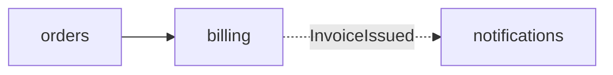

# Modular Monolith

One deployable split into **application modules** under the laws below,
held by a **fitness function** — a CI check that goes red on a violation.

This skill produces the `### Module map` subsection and the module rows of
`### System invariants` inside the `## System Architecture` section that
`system-architecture` appends to the spec. The connections between modules
are this skill's layer; the depth of each published interface is
`codebase-design`'s.

## The laws

Every branch applies all seven; each one is a row of `### System
invariants` (law → negation → where verified).

1. **One module, one bounded context.** The module is named with a
   `CONTEXT.md` term; a module whose name needs "and" is two modules.
2. **Published interface only.** Other modules import from the module's
   published interface (in Python: `<module>/api.py`); everything else is
   internal. The published interface speaks only domain types and IDs.
3. **Data ownership.** Each table belongs to exactly one module, which
   alone reads and writes it. Another module gets that data through the
   published interface or holds its own copy fed by events; references
   across modules are bare IDs. A cross-module report reads a read model fed
   by events.
4. **Acyclic dependencies.** The module dependency graph is a DAG, and every
   edge is declared in the module map.
5. **Call for an answer, event for a reaction.** A module calls another's
   published interface when it needs the result to continue; it publishes an
   in-process domain event when other modules only react. The event schema is
   part of the publisher's published interface. For each event, state whether
   subscribers run inside the publisher's transaction or after commit (with
   an outbox when losing the event is unacceptable). A transaction spanning
   modules is resolved into a call plus compensation, or an event.
6. **Thin shared kernel.** `shared/` holds only technical primitives (IDs,
   money, clock, event bus) and imports no module. A domain concept in
   `shared/` belongs to a module.
7. **Tested through the published interface.** A module's tests exercise it
   through its published interface, with other modules replaced at theirs.

## Process

### 1. Pick the branch

| The situation | Branch |
|---|---|
| No code yet, or a new system | [GREENFIELD.md](GREENFIELD.md) |
| A feature on a monolith that already has modules and a fitness function | [FEATURE.md](FEATURE.md) |
| An existing codebase without enforced module boundaries | [MODULARIZE.md](MODULARIZE.md) |

Read the branch file now and run its steps; its last line names the step
of this file to continue from.

_Done when: the branch is named in the session, with the evidence for it
(the fitness function config found or absent, the package layout)._

### 2. Write or extend the fitness function

Follow [ENFORCEMENT.md](ENFORCEMENT.md) for the stack. Then prove each new or
changed contract can fail: add a **control violation** for it (an import of
another module's internals, a cycle, a shared-kernel import) in a scratch
change, run the check, see that contract red, discard the change.

_Done when: the check runs in the repo's canonical CI command and passes on
the real code; laws 2, 4 and 6 each map to a named contract; every contract
added or changed in this run went red on its control violation._

### 3. Write the module map

Draft it for the `## System Architecture` section, before `### System
invariants` (`system-architecture` step 4 appends both):

````markdown
### Module map

| Module | Bounded context (CONTEXT.md) | Published interface | Owns (tables) | Depends on | Publishes events |
|---|---|---|---|---|---|
| billing | Billing | `billing/api.py`: `charge(order_id, amount) -> Charge` | `invoice`, `charge` | orders | `InvoiceIssued` (after commit, outbox) |


````

In the sequence diagrams of `system-architecture`, participants are modules
and messages are published-interface calls or events. Mark changes with the
`+ / ~ / -` diff notation when the map already exists.

Write one `### System invariants` row per law. **Verified in** is the
fitness-function contract for laws 2, 4 and 6; for the others, the test or
review-time check that ENFORCEMENT.md names for the stack.

_Done when: every module touched by the spec has a row with all six columns
filled (`—` where there is nothing); every arrow in the diagram is a "Depends
on" or "Publishes events" entry and vice versa; every event states its
transaction semantics; all seven laws have an invariant row._

Return to `system-architecture` step 3 for the remaining artifacts.
