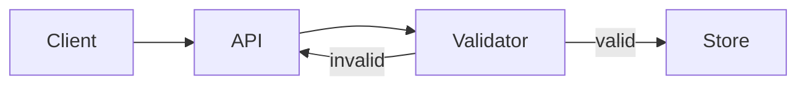
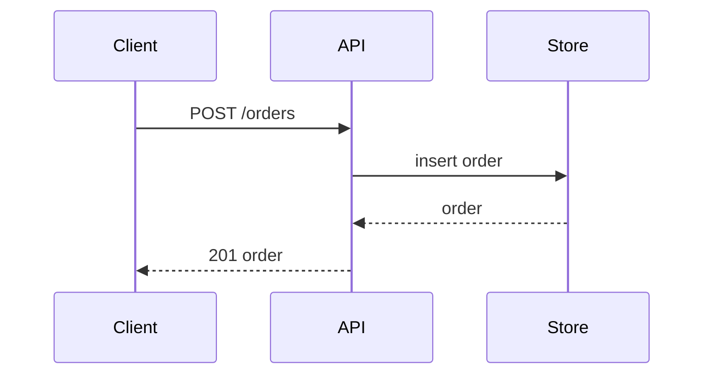
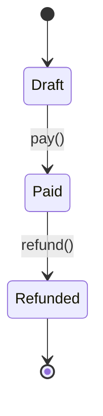
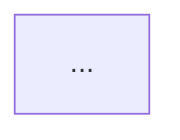
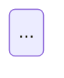

# UML Modeling

`$ARGUMENTS` is the feature/spec/ticket. The model answers one question for a
reader who does not read the code: **what does this feature do, what does it
talk to, and through which states does it move?**

It is not a second architecture document. The contracts, the data model and
the invariants stay in the spec (`## System Architecture`); the model owns the
**diagrams**.

## Where it runs

| Checkpoint | Produce | Home |
|---|---|---|
| after Phase 1 (spec) | flow + statechart | `## Model` in the spec issue |
| after Phase 3 (architecture) | sequence + reconcile flow/state | `## Model` in the spec issue |
| Phase 6, before the PR | as-built + `## Model changes` | `docs/models/<feature>.md` |

The model is **default-on** for every feature in the pipeline. Skip it, with a
reason, only when the feature adds no flow, no interaction and no state:
`Model skipped — <reason>`. An empty diagram is worse than an honest skip.

## 1. Inventory

Read the spec, the architecture section, `CONTEXT.md` and the code area.
Then fill `## Lifecycle inventory` **before** drawing anything:

| Entity | Moves in time? | Statechart |
|---|---|---|
| `Order` | yes — status + transitions | required |
| `Config` | no — static values | — |

A statechart is **required** when any of these is true:

- a `status`/`state` field or column, or an enum of states;
- a job/queue/worker lifecycle;
- retry/backoff/timeout;
- an approval or review workflow;
- multi-step onboarding/checkout;
- a document or processing lifecycle;
- subscription/billing;
- explicit transition methods or events;
- an existing state machine the feature touches.

If none applies, write `no — <reason>` for every entity. Do not omit the
inventory: the absence of a lifecycle is a fact worth recording.

## 2. Elements

Every diagram ID must map to the code. Build `## Elements` before or while
drawing:

| ID | Kind | Code | Source |
|---|---|---|---|
| `API` | module | `pkg.api` | `pkg/api.py` |
| `Order` | entity | `pkg.models.Order` | `pkg/models.py:12` |
| `POST /orders` | route | `pkg.api.create` | `pkg/api.py:40` |
| `Stripe` | external | `https://stripe.com/docs/api` | contract |

Kinds: `module`, `symbol`, `entity`, `route`, `external`. Use the code's real
IDs; the checker resolves them against the facts. If an ID is not in the code
yet (design-time), mark the row and fill it at as-built.

## 3. Diagrams

Use Mermaid in fenced blocks. Keep every diagram at the altitude of the
reader: domain names, not function names; a component, not every class.

### Flow

A `flowchart` for each relevant scenario (happy path, error path), labelled:



One step per domain action. Branches carry their condition on the edge.

### Sequence

A `sequenceDiagram` for each interaction scenario. Participants are real
components or external systems, not functions:



Return arrows (`-->>`) carry responses; request arrows (`->>`) carry payloads.
If the feature has multiple flows, use separate diagrams with clear labels.

### State machine

A `stateDiagram-v2` for every entity whose inventory says it moves in time.
Put each machine under a `### <Entity>` heading: the checker uses the heading
to compare the states with the code's enum values (case-insensitive), so a
state added in code and forgotten in the model is caught. States are domain
states; transitions name the action, not the implementation:

````markdown
### Order


````

If the machine already exists, show only the delta and mark it in comments or
labels with `+` (new), `~` (modified), `-` (removed); do not redraw the whole
machine. A statechart that does not fit on one screen is a sign the entity
should be split, not that the diagram needs more detail.

## 4. Design-time checkpoints

### After Phase 1 — spec

Append `## Model` to the spec issue with:

- `## Lifecycle inventory`;
- `## Elements` (what is known);
- `## Flow` for the main scenarios;
- `## State machines` for every triggered entity.

The sequence may wait: components and contracts are not decided yet. If the
spec already names them, add it now.

### After Phase 3 — architecture

Add `## Sequence` using the real components and contracts. Reconcile the flow
and the statecharts with the architecture; if the architecture moved a
boundary or changed a transition, update the model **and** record the change.

The module map of Phase 3 is the source of area boundaries. Do not invent a
new taxonomy in the model. If the boundaries are unclear, that is a finding
to escalate, not a `core` area to improvise.

## 5. As-built

Before the PR, after the code is written:

1. Create `docs/models/<feature>.md` from the design snapshot.
2. Regenerate the mechanical facts and reconcile `## Elements`:

   ```bash
   python3 guards/check_model.py docs/models/<feature>.md --gate
   ```

   In a repo where the Python adapter does not apply, pass the facts file, or
   keep it at `docs/models/facts.json` (the checker and the pre-push hook pick
   it up automatically):

   ```bash
   python3 guards/check_model.py docs/models/<feature>.md --gate --facts facts.json
   ```

3. Add a `## Model changes` row for every **semantic** change between design
   and as-built — a new step, a different order, a new state/transition, a
   removed path, a changed component boundary. Each row links the owner's
   approval comment. Mechanical changes (rename, moved file, extra parameter)
   do not enter the table: the PR diff shows them.
4. Run the gate (exit 0) before the PR. Put `Model: docs/models/<feature>.md`
   in the PR body, or `Model: n/a — <reason>` if the model was skipped.

The file shows the **current truth**. The design snapshot stays in the issue
as history; the `## Model changes` table is the human-readable delta.

## 6. Escalation

If implementation discovers that the agreed model does not hold:

1. **Stop before writing the deviating code.** The implementer reports to the
   coordinator; the coordinator stops the loop.
2. Post a `## Decision` on the ticket/PR: the design element, the proposed
   element, why the design does not hold, the alternatives, the consequences.
3. Wait for an explicit owner comment. A chat "ok" is not enough: the approval
   must be linkable.
4. Update the model and the ticket, then add the `## Model changes` row with
   the approval link. Resume implementation only after that.

An as-built semantic delta without an approval link is a `fatal` finding for
the Spec axis. The as-built extraction is the safety net, not the normal
moment of approval.

## Rendering

GitHub/GitLab render the Mermaid blocks directly. For a polished local view,
`skill://archify` can render the same blocks to `.scratch/`; do **not** commit
the HTML — it would be a second copy that drifts.

## Format

````markdown
---
feature: <slug>
area: <area>
entities: [<Entity>, ...]
issue: <url>
---

# Model: <feature>

## Lifecycle inventory

| Entity | Moves in time? | Statechart |
|---|---|---|
| ... | ... | ... |

## Elements

| ID | Kind | Code | Source |
|---|---|---|---|
| ... | ... | ... | ... |

## Flow



## Sequence

```mermaid
sequenceDiagram
  ...
```

## State machines

### <Entity>



## Model changes

| # | Element | Change | Why | Approval |
|---|---|---|---|---|
| ... | ... | ... | ... | ... |

## Notes

...
````

## Facts interface

The checker consumes `model-facts/1`; it does not know the language. The
Python adapter (`guards/model_facts_python.py`) emits modules, symbols, calls,
routes, enum states and state candidates. Any repo can provide its own JSON
with `--facts` or at `docs/models/facts.json`; a TypeScript adapter is the
next planned one. The pre-push hook runs with `--strict`, so a repo with
models but no facts provider fails visibly instead of passing on structure
alone.

The contract is in the adapter's docstring. The model's semantics are not
extracted: the code verifies the skeleton, the reviewer judges the intent.

## Levels (later)

v1 is per-feature. The target is a model at levels:

```
docs/models/
  README.md              # generated index: tables + area map
  system.md              # context + areas + cross-area flows
  areas/<area>.md        # current truth for the area
  entities/<entity>.md   # full statechart
  <feature>.md           # feature delta and detail
```

Do not create those levels in v1. Keep `area` and `entities` in the front
matter so the index and the aggregation can be added without reworking the
model.

## Anti-patterns

- **A call graph for a non-coder.** Code-level nodes and edges are true and
  useless for this reader. Stay at domain/component altitude.
- **Diagrams without `## Elements`.** A picture that cannot be checked is an
  opinion.
- **Self-approval.** The agent does not write the owner's approval link; it
  asks for it.
- **A statechart for every class.** The inventory decides; no lifecycle, no
  statechart.
- **Duplicating the architecture contracts.** The model shows behavior; the
  spec owns contracts, data and invariants.
- **A model that grows every time.** If the system doc needs a sixth
  cross-area flow or the statechart fills two screens, the problem is the
  boundaries, not the diagram.
